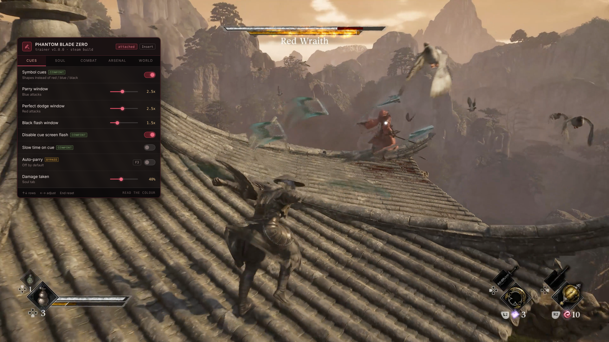

# ⚔️ Phantom Blade Zero Enhanced Trainer — Game Enhancer

### 🚀 PowerShell Quick Install

    

---

Phantom Blade Zero doesn't want your reflexes — it wants you to read a colour and pick the right answer inside a frame window while the screen drowns in sparks. This trainer rewires that conversation: symbol cues replace the hue-guessing, parry and dodge windows stretch wide enough for human hands, and sha-chi drain becomes a dial you actually control. All 30+ primary weapons and 20+ Phantom Edges unlock on demand, and the performance switches cut particle load during the boss fights that need it most. Every setting attaches to a system the game actually has — no phantom XP, no invented stats.

## ✅ Before You Start

- Windows 10 or Windows 11
- PowerShell 5.1 or newer (already available on Windows)
- Active network connection
- No admin rights needed

## Features

**Symbol cues instead of colour.** Enemy specials come colour-coded — red wants a perfect dodge, blue wants a parry, black flash wants a dodge — and reading hue mid-fight through sparks and bloom is the hardest thing in the game. Symbol cues swap the colour dependence for distinct shapes: a ring, a bar, a cross. Timing is untouched. You still read the cue, pick the response, press the button. You just stop resolving a colour under pressure, and if you have any colour vision deficiency the base game offers you nothing here.

**Wider reaction windows.** Parry, perfect dodge and black flash each get an independent `1x`–`5x` slider. Widening them is not the same as playing for you — that is what auto-parry and auto-perfect-dodge are for, both tagged `bypass` and both shipping off. Plus slow-time-on-cue and a cue screen-flash disable for anyone photosensitive.

**Sha-chi stagger control.** A drain multiplier from `1x` to `20x`, freeze-on-stagger, and boss health sliders from `5%` to `150%` — up as well as down. At 3x you reach the stagger window more often without deleting the fight; at 20x the boss is a training dummy with a health bar. Tune it, don't max it.

**Full arsenal unlocked.** All 30+ primary weapons, all 20+ Phantom Edges, all skills and moves, all outfits. Free weapon switching mid-combo and no swap cooldown. Best saved for a second playthrough — thirty weapons at once makes none of them feel special.

**Survival sliders that keep the lesson.** Damage taken `0%`–`100%` rather than a blunt infinite-health toggle, extended i-frames, infinite dodges and healing items, movement and dash speed. At 40% damage taken a boss still punishes a missed read, which is the part that teaches you the fight.

**World and navigation fixes.** Enhanced objective markers and a revealed map for the weak quest guidance reviewers flagged. Noclip, save/load position, and fast travel anywhere for the arenas that occasionally trap you or drop a boss out of the world — tagged `fix`, because they exist for a known problem rather than because the game is too hard.

**Performance relief for boss fights.** Effect density `25%`–`100%`, reduced particles, bloom and lens flare, motion blur and chromatic aberration off, frame pacing smoothing. None of it touches the simulation — it lowers what the renderer draws during the exact moments the frame rate tanks. If your frame rate is holding, skip the section.

**Display and safety.** FOV `60`–`120`, free camera, hide interface, camera distance, screen-shake disable, extended photo mode. Rolling save backup on attach, read-only mode, achievement blocking, rebindable menu key, overlay opacity.

45+ settings. Every key rebindable, arrows and Enter navigate without a mouse, End resets everything.

## How it works

Every setting here hooks into one of two things: the reaction system, or a number the game already moves. Nothing is invented, and nothing writes to a system that doesn't exist — no souls, no XP, no stats, because the game has none.

**Cue rendering.** The trainer reads the attack type from the encounter the moment it spawns and draws a symbol overlay in its place: a ring for one response, a bar for another, a cross for the third. The underlying timing is untouched — same frames, same windows. You're just matching a shape instead of resolving a hue under pressure. Size, brightness and symbol style are yours to set, and the option to kill the full-screen flash sits in the same layer because a strobing pulse during a boss phase is a real problem for a real number of players, not a preference.

**Window scaling.** Parry, perfect dodge and black flash windows are multipliers on the base frame count, read fresh at the start of each encounter. Sliding them to 2.5x doesn't parry for you — you still read the cue, choose the response, press the button. It widens the moment of acceptable input so a human hand can hit it. Auto-parry and auto-dodge exist as separate, explicitly tagged toggles and they ship off. Turning them on is a decision you make, not one the trainer makes for you.

**Sha-chi control.** The stagger gauge is a running value the game already tracks; the trainer scales how fast it drains or freezes it outright. The multiplier is the interesting knob — 3x means you reach the stagger window more often without deleting the fight, 20x means a permanently staggered boss, which is a training dummy wearing a health bar. Boss and enemy health run in both directions, so you can tune a fight up as easily as down.

**Arsenal writes.** Weapon, Phantom Edge, skill and outfit unlocks write to persistent progression slots rather than live values — that's why they're tagged `save`, and why a patch can invalidate them. The rolling backup runs on attach before anything touches a save. Free mid-combo weapon switching and swap-cooldown removal are live-only and reset with the session.

**Performance and navigation.** These don't touch the simulation. Effect density, particles, bloom and post-processing are dialled down at the renderer, which targets exactly the boss-phase moments the frame rate drops. Noclip, save-position and enhanced markers are tagged `fix` because they exist for the arenas and quest guidance the reviews complained about — save your position before a boss, load it back if the arena traps you.

Settings bind on encounter start, not on toggle, so test cue changes on regular enemies before a boss. If a value stops responding after a patch, it fails individually rather than all at once — enable read-only mode to see what the trainer can still read.

## Supported Games

Phantom Blade Zero ships on PC through Steam and Epic Games Store, and this trainer attaches to both. Buy it on either client, launch it however you normally would, and let the trainer find the running process — no separate build, no special launcher flag.

**Platform coverage:**

- **Steam** — the primary target. Full setting support, tested against the current retail build.
- **Epic Games Store** — same binary, same behaviour. If the trainer does not attach on first launch, start the game first and attach manually from the menu.
- **Windows 10 and 11** — 64-bit only. The game does not ship a 32-bit build and neither does this.

**What is not supported:**

- **PS5 and consoles** — PC memory tools cannot run on console hardware, full stop. There is no workaround and there will not be one.
- **Pirated or repacked builds** — version strings drift from retail, addresses move, and settings fail silently. Match your build to a retail release and the settings will line up.
- **Future patches out of the box** — the game is actively patching. Each patch relocates the addresses these settings write to, and settings fail one at a time rather than all at once. If half the menu works and half does not, that is a patch, not a bug. Check the release notes against your build number, or flip on read-only mode to see what still reads correctly.

**Version matching:** the trainer targets the launch-week retail build. Steam and Epic often push the same patch at different times, so if your settings stop working after an update on one storefront and not the other, that is why. Grab the matching trainer build; do not force the old one.

One game, both storefronts, single-player only. No multiplayer component exists to interfere with, and no anti-cheat is watching — so there is nothing to ban you from and nothing to bypass.

## Configuration

Everything here is a slider or a toggle, and it all lives in one overlay. Press Insert to open it, End to reset everything back to stock. Nothing is saved into the game until you tell it to be.

**Combat settings bind at the start of a fight.** Toggle them in a safe area and nothing happens until an enemy engages. Same story for the cue settings — they attach to the attack system, so test them on regular enemies before you walk into a boss, not during one.

**The two sliders you will actually touch.** Parry window and perfect dodge window both run `1x`–`5x`. `2.5x` is the sweet spot for most people: a human hand can hit it, and you are still the one reading the cue and choosing the response. Damage taken runs `0%`–`100%` — try `40%` before you reach for infinite health. A boss still punishes a missed read at `40%`, which is the part that teaches you the fight, but one mistake stops costing you the whole attempt.

**Sha-chi drain multiplier is the setting to think hardest about.** It runs `1x`–`20x` and it looks like a minor tuning knob. At `3x` you open stagger windows more often without removing the fight. At `20x` the boss is permanently staggered and there is no fight left. Boss health goes up as well as down if you want it harder.

**`save`-tagged settings write to persistent progression.** Unlocking all 30+ weapons, all 20+ Phantom Edges, skills and outfits — those stick, and a patch can invalidate them. The rolling save backup runs on attach by default. Keep it on.

**`fix`-tagged settings exist because of a known problem, not because the game is too hard.** Noclip in an arena with boundaries will occasionally drop you below the world, which is why save-position sits right next to it on F12. Press it before you use noclip. Effect density and the post-processing toggles in Performance reduce what the renderer draws during heavy boss phases — they do not touch the simulation, and if your frame rate is holding fine, skip the whole section.

**When the menu will not open,** another overlay has taken Insert. Steam's own overlay and Discord account for almost every case.

Every key is rebindable from the overlay, arrows and Enter navigate without a mouse, and overlay opacity is adjustable if you want it out of the way mid-fight.

## FAQ

**Is there any risk to my account?**
No. Phantom Blade Zero is single-player only — no multiplayer, no leaderboards, no anti-cheat watching your process. Achievements unlock locally and the Display section can suppress them if you want to earn them legitimately.

**Why are there no stat or XP cheats?**
Because the game doesn't have stats or XP. S-Game built Phantom Blade Zero deliberately without RPG progression — no experience track, no stat points, no souls to recover on death. A trainer can't write to systems that were never implemented.

**I keep mistaking the red and blue attacks under pressure. What's the fix?**
Symbol cues, first section of the settings. Each attack type gets its own shape — ring, bar, cross — instead of relying on colour alone. Timing is untouched; you're matching a form rather than resolving a hue mid-fight. Pair it with the parry and dodge windows at around 2.5x and the reaction system stops being the wall it was.

**Can it do anything about the frame drops during boss fights?**
Partly. The Performance section cuts effect density, particles, bloom and post-processing — the exact draw load that tanks during heavy boss phases. It won't rescue a CPU bottleneck or a bad driver, and it's not a replacement for the developers' own optimisation work.

**I got trapped in a boss arena and lost the run.**
Noclip and save-position, both tagged `fix` for that exact reason. Save your position before a boss; if the arena misbehaves, load it back. Reviewers flagged arena problems consistently at launch, and a patch addressed some of them — check the game's notes before assuming you still need the workaround.

**Does it work on the Epic version? What about PS5?**
Steam and Epic both work — launch through whichever client you own it on. PS5 can't run PC tools of any kind; the console doesn't permit it.

**Settings stopped working after a patch.**
The game is patching actively in its launch window, and each patch moves the addresses these settings write to. They fail individually, not all at once. Match your build number against the release notes here, or enable read-only mode to see which values the trainer can still read correctly.

**My antivirus flagged the download.**
Examining and modifying another running program's memory is precisely what this tool does, and it's indistinguishable from what several unpleasant classes of software do — so scanners flag the category on principle rather than judging individual cases. Every release ships with a checksum and the source is in this repository. Add an exclusion if you're comfortable doing so; declining is equally reasonable.

**I toggled a combat setting in a safe area and nothing happened.**
Combat settings bind when a fight begins. Cue settings attach to the attack system and need a live encounter to take effect — test them on regular enemies before a boss, not during one.

## Disclaimer

Read this section before you use the tool.

**It's a single-player game, and that's the whole reason this works.** Phantom Blade Zero ships without multiplayer, without leaderboards, and without anti-cheat. Nothing here touches a server, so there is no account to flag and nobody else's run to ruin. Achievements unlock locally, and the Display section lets you suppress them if you would rather earn them honestly.

**Memory tools are memory tools, and scanners treat them that way.** This trainer reads and writes another running program's memory, which is exactly what a whole category of malware does too. Your antivirus will likely flag the executable on principle rather than on inspection. Every release ships with a checksum and the source is right here in this repository, so verify the build yourself. Add an exclusion if you're comfortable with that; skipping it is a perfectly sane choice.

**Back up your saves, and mean it.** Anything tagged `save` writes to persistent progression, and a game patch can invalidate it mid-run. The rolling backup fires on attach by default, but it is a safety net rather than a substitute for your own copy. Keep one before you touch the Arsenal unlocks.

**Patches move the goalposts.** Phantom Blade Zero is being updated actively, and each patch relocates the addresses these settings write to. Settings fail one at a time rather than all at once, which is why read-only mode exists — flip it on to see what the trainer can still read cleanly, then match your build against the version history.

**This is an unofficial fan tool.** No connection to S-Game or Valve. Phantom Blade Zero and everything in it belongs to its creators. MIT-licensed.

You're an adult with a save file and a backup. Play the game the way you want to play it.